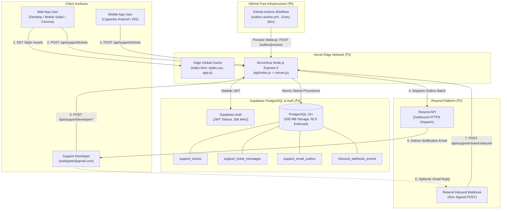
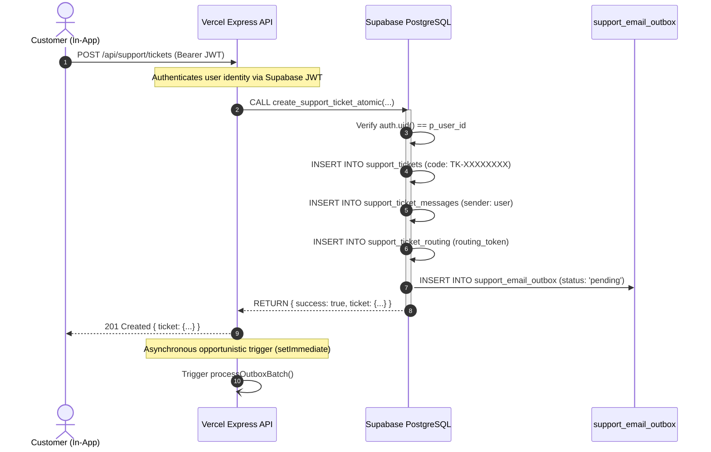
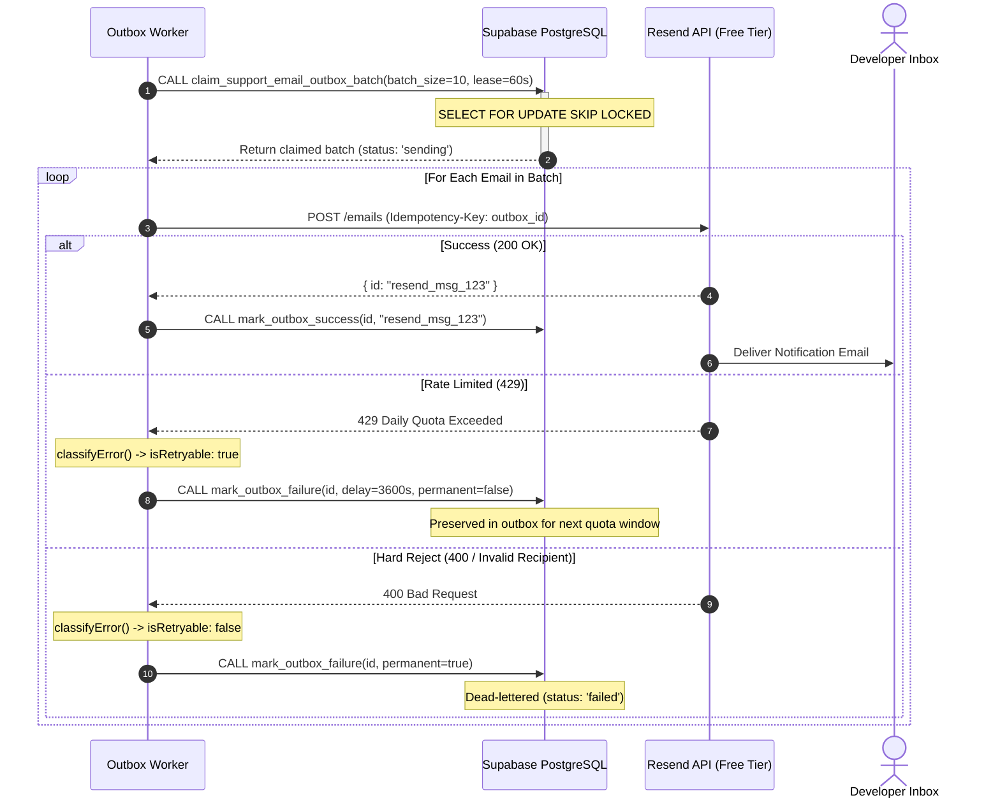
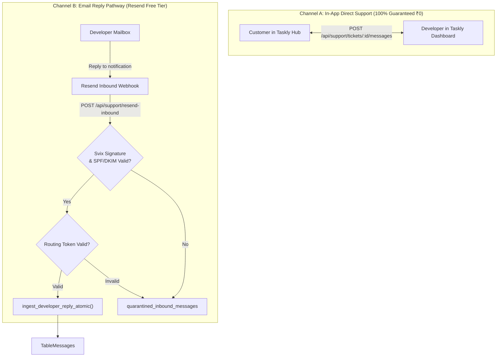

# Taskly v2.2.0 (Build 14) — Zero-Cost Architecture Specification

## 1. Architectural Philosophy

The Taskly Customer Support & Productivity System is engineered to operate reliably at production scale with **zero monthly cloud expenditure (₹0 / month)**. 

To achieve this, the architecture leverages:
1. **Zero-Billing Providers**: Platforms (Vercel Hobby, Supabase Free, Resend Free, GitHub Actions Free) that enforce hard execution caps rather than billing overages.
2. **Transactional Outbox Pattern**: Decoupling user actions from external email delivery, preventing slow API timeouts and guaranteeing at-least-once delivery.
3. **Dual-Trigger Asynchronous Processing**: Combining real-time opportunistic event execution with scheduled GitHub Actions cron jobs to eliminate the need for paid cloud scheduler instances.
4. **Autonomous In-App Support Chat**: Decoupling customer-developer communication from third-party email providers, ensuring zero loss of support capability when email quotas are depleted.

---

## 2. End-to-End System Topology

---

## 3. Core Component Workflows

### 3.1 Ticket Creation & Transactional Enqueueing

### 3.2 Outbox Processing & Delivery

### 3.3 Inbound Email & In-App Dual Channels

---

## 4. Operational Guardrails

### 4.1 Memory & Execution Duration Bounds
- Node.js heap limit within Vercel Serverless Function: Default 1024 MB.
- Outbox batch size is hard-capped at **10 emails per run**.
- Database connection limits: Uses `@supabase/supabase-js` HTTP API and connection pooling, completely eliminating connection leaks.

### 4.2 Deduplication & Anti-Replay
- **Outbound Emails**: Uses a cryptographic SHA-256 deduplication key (`ticket-created-<ticketId>`) stored in `support_email_outbox.deduplication_key`. Unique index prevents duplicate rows.
- **Inbound Webhooks**: Uses `inbound_webhook_events.event_id` with atomic database claiming (`claim_inbound_webhook_event`). Replayed webhooks receive HTTP 200 with `{ status: "already_processed" }`.

### 4.3 Resilience to External Outages
- If Resend experiences downtime or revokes API access, the application remains fully functional.
- Customers can create tickets, view history, and exchange messages. Developers can view, filter, assign, and reply to tickets from the Developer Dashboard.
- Neither customer support nor core task management ever stops due to third-party email failures.

