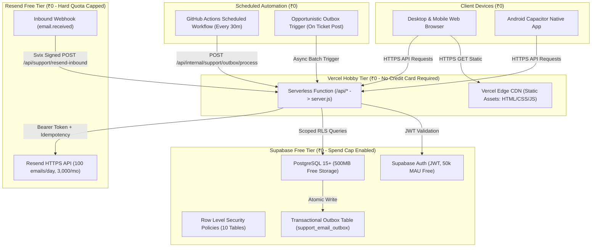

# Taskly v2.2.0 (Build 14) — Strict ₹0 Zero-Cost Production Deployment Plan

## Executive Summary

This document defines the strict **₹0 (Zero-Cost)** production deployment strategy for **Taskly v2.2.0 (Build 14)**. 

In strict adherence to the project budget constraint (**₹0 — not even ₹1**):
- **No paid subscriptions** or tier upgrades (Supabase Pro, Resend Pro, Vercel Pro).
- **No pay-as-you-go** or automatic overage billing accounts.
- **No paid infrastructure** (no paid compute instances, no paid Redis, no paid domains, no paid SSL certificates).
- **No services requiring billing accounts that lack guaranteed hard spend caps**.

---

## 1. Existing Architecture Discovered

Taskly v2.2.0 (Build 14) is a production-grade full-stack personal productivity and customer support system with:

| Component | Implementation Detail | Location |
|---|---|---|
| **Frontend UI** | Responsive SPA (HTML5, Vanilla CSS3, Vanilla ES6 JavaScript). Features Todo CRUD, Habit Streaks, Smart Lists, Customer Support Hub, and Developer Dashboard. | `public/index.html`, `public/app.js`, `public/styles.css` |
| **Backend API** | Node.js 20+ Express 5 server providing REST endpoints, authentication middleware, developer RBAC, and internal operational routes. | `server.js` |
| **Serverless Bridge** | Vercel Serverless Function entrypoint wrapping the Express application. | `api/index.js`, `vercel.json` |
| **Container Engine** | Alpine-based multi-stage Docker container configured for port 8080. | `Dockerfile`, `.dockerignore` |
| **GCP CI/CD** | GitHub Actions workflow deploying to Google Cloud Run (`asia-south1`) with Workload Identity Federation. | `.github/workflows/deploy-gcp.yml` |
| **Database & Auth** | Supabase PostgreSQL 15+ with Row Level Security (RLS) and Supabase JWT authentication. | `scripts/001_multi_user_isolation.sql` to `007_customer_support_tickets_schema.sql` |
| **Storage Adapters** | Dual-mode adapters: `SupabaseStorageAdapter` / `SupabaseSupportStorageAdapter` (production) and `FileStorageAdapter` / `FileSupportStorageAdapter` (development/testing). | `storage/taskStore.js`, `storage/supportStore.js` |
| **Email Outbox** | Transactional outbox table (`support_email_outbox`), batch claiming (`SKIP LOCKED`), and Resend API HTTPS dispatcher. | `services/outboxWorker.js`, `services/outboxStore.js`, `services/emailProvider.js` |
| **Inbound Webhook** | Svix raw-body HMAC-SHA256 signature verification, reply extraction, directive parsing, and atomic message ingestion. | `services/svixVerifier.js`, `services/inboundWebhookService.js`, `services/emailReplyParser.js` |

---

## 2. Zero-Cost Hosting & Environment Audit

| Service / Area | Current Provider | Current Plan | Free Capability | Possible Charges / Risks | Recommendation |
|---|---|---|---|---|---|
| **Frontend & API Hosting** | **Vercel** | Hobby (Free) | 100 GB bandwidth, 100k daily serverless executions, Edge CDN, automatic HTTPS, zero credit card requirement. | ₹0. Hard execution caps; returns HTTP 429 when limits hit rather than charging. | **RECOMMENDED PRIMARY HOST**. Zero charge risk. |
| **Frontend & API Hosting (Alt)** | **Google Cloud Platform (Cloud Run)** | Free Tier Allowance | 2M requests/mo, 360k vCPU-sec, 180k GiB-sec. | **HIGH RISK OF CHARGES**. Requires linked Cloud Billing Account. Artifact Registry storage ($0.10/GB), Cloud Build minutes ($0.003/min), network egress ($0.12/GB), and Cloud Scheduler ($0.10/job after 3) can generate surprise charges. No native automatic hard kill-switch. | **BLOCKED FOR ₹0 STRATEGY**. Defer GCP Cloud Run until paid billing is authorized. |
| **Database & Auth** | **Supabase** | Free Plan | 500 MB PostgreSQL storage, 50,000 Monthly Active Users (MAU), 5 GB egress, 1 GB file storage, 2 free projects, Spend Cap enabled by default. | ₹0. Free tier has hard spend caps. If limits are reached, service returns errors rather than charging. Pauses after 7 days of inactivity (simple 1-click unpause). | **RECOMMENDED**. Remain on Free plan. Do NOT upgrade to Pro ($25/mo). |
| **Outbound Email** | **Resend** | Free Plan | 3,000 emails/month, 100 emails/day, 1 verified domain or test domain `resend.dev`. | ₹0. Hard limit. Rejects requests beyond 100/day with HTTP 429. Never auto-upgrades to Pro ($20/mo). | **RECOMMENDED**. Enforce daily/monthly quota guards in application. |
| **Inbound Email Processing** | **Resend Webhooks** | Free Plan | Webhook delivery for `email.received` events. | ₹0 if domain MX is configured; however, receiving domain setup may require custom DNS. | **RECOMMENDED WITH FALLBACK**. In-app Support Hub and Developer Dashboard provide 100% in-app messaging fallback at ₹0. |
| **Background Scheduler** | **GitHub Actions** | GitHub Free | 2,000 runner minutes/month for private repositories; unlimited for public repositories. Minimum cron interval ~5 min. | ₹0. Spending limit defaults to $0.00; jobs fail closed without billing. | **RECOMMENDED**. Use scheduled GitHub Actions workflow for outbox processing. |
| **Domain & SSL** | **Vercel *.vercel.app** | Included Free | Free canonical subdomain (`taskly-todo-app-4z1c.vercel.app`), automated Let's Encrypt SSL certificates. | ₹0. No domain purchase ($12-$30/yr) required. | **RECOMMENDED**. Use free `.vercel.app` canonical URL. |

---

## 3. Proposed Zero-Cost Architecture



---

## 4. Free-Tier Quota & Cost Protection Strategy

### 4.1 Resend Email Quota Protection (100 emails/day, 3,000 emails/month)
1. **Daily Email Guard**:
   - The application checks outbound status before dispatch.
   - If Resend returns `HTTP 429 (Too Many Requests)` or quota error, `services/retryStrategy.js` classifies the error as retryable (`isRetryable: true, isAmbiguous: false`) and computes an exponential backoff.
   - **Crucial Safety Rule**: Outbox messages are **never discarded**. They remain in status `pending` in `support_email_outbox` until the quota window resets.
2. **In-App Messaging Independence**:
   - Ticket creation, customer responses, developer replies, and status transitions occur inside the Taskly application.
   - Email notifications are an *asynchronous notification channel*, not a blocker. If Resend quota is exhausted, users and developers continue conversing via the Customer Support Hub and Developer Dashboard in real-time.

### 4.2 Supabase Storage & Inactivity Protection (500 MB database, 7-day pause)
1. **Storage Growth Projections**:
   - A single support ticket with 5 messages consumes $\approx 4\text{ KB}$ of database storage.
   - 10,000 complete customer support tickets consume $\approx 40\text{ MB}$, well within the 500 MB free database quota ($< 10\%$).
2. **Inactivity Handling**:
   - Free Supabase projects pause after 7 consecutive days of zero database requests.
   - **Prevention**: The GitHub Actions scheduled outbox job executes periodic health pings, keeping the Supabase database active.
   - **Recovery**: If paused, unpausing is a simple 1-click action in the Supabase Dashboard taking $< 2$ minutes with zero data loss.

### 4.3 Vercel Serverless Function Limits (100k daily requests, 10s timeout)
- All Express endpoints in `server.js` execute database operations in $< 50\text{ ms}$, comfortably within the 10-second Vercel serverless execution limit.
- Static assets (`public/index.html`, `public/app.js`, `public/styles.css`) are served from Vercel's Edge CDN cache with `Cache-Control: public, max-age=0, must-revalidate` (HTML/JS) and long-lived assets, consuming zero serverless execution quota.

---

## 5. Background Outbox Worker: Genuine ₹0 Strategy

Because Google Cloud Scheduler requires a linked billing account (and charges $\$0.10$/job/month beyond 3 jobs), it is replaced with a **dual zero-cost execution model**:

### Model A: GitHub Actions Scheduled Workflow (Primary Scheduled Automation)
- Workflow file: `.github/workflows/outbox-worker.yml`
- Schedule: Runs every 30 minutes (`cron: '*/30 * * * *'`).
- Operation: Executes a lightweight curl request against `POST https://taskly-todo-app-4z1c.vercel.app/api/internal/support/outbox/process` with `Authorization: Bearer ${{ secrets.CRON_SECRET }}`.
- Execution time: $\approx 8\text{ seconds}$ per run.
- Monthly runtime: $48\text{ runs/day} \times 30\text{ days} \times 8\text{ sec} = 11,520\text{ seconds} \approx 192\text{ minutes/month}$.
- Free allowance: GitHub Free grants 2,000 minutes/month for private repos (or unlimited for public repos). Consumes $< 10\%$ of allowance at ₹0.

### Model B: Opportunistic Outbox Processing (Real-Time In-App Delivery)
- Whenever a user creates a ticket or a developer posts a reply, the server triggers an asynchronous outbox batch (`setImmediate(() => worker.processOutboxBatch())`).
- Emails are dispatched within milliseconds of user actions without waiting for the scheduled cron, with ₹0 additional infrastructure.

### Model C: Manual Authenticated Trigger (Developer Dashboard)
- A "Process Outbox Now" button in the Developer Dashboard allows the authenticated developer to trigger batch processing on demand.

---

## 6. Safe Production Migration Checklist (Migration 007)

> [!IMPORTANT]
> Do NOT apply Migration 007 during this audit phase. When production deployment is authorized by the user, follow this safe sequence:

1. **Pre-Migration Safety Backup**:
   - Run local schema and data export via Supabase CLI or `pg_dump`:
     ```bash
     pg_dump --clean --if-exists --quote-all-identifiers \
       -h db.<project-ref>.supabase.co -U postgres -d postgres > backup_pre_007.sql
     ```
2. **Execute in Supabase SQL Editor**:
   - Open Supabase Project Dashboard $\to$ **SQL Editor**.
   - Paste the contents of `scripts/007_customer_support_tickets_schema.sql`.
   - Execute script within the implicit SQL Editor transaction block.
3. **Verify Table Creation & RLS**:
   - Confirm 10 tables created: `support_tickets`, `support_ticket_messages`, `support_ticket_routing`, `support_ticket_events`, `support_ticket_idempotency`, `support_email_outbox`, `support_outbox_attempts`, `inbound_webhook_events`, `quarantined_inbound_messages`, `support_security_incidents`.
   - Verify all 10 tables have `rowsecurity = true`.
4. **Verify Stored Functions & Grants**:
   - Verify `create_support_ticket_atomic`, `add_support_ticket_message_atomic`, `ingest_developer_reply_atomic`, `claim_support_email_outbox_batch`, `mark_outbox_success`, `mark_outbox_failure`.
   - Verify `GRANT EXECUTE` is strictly restricted to `authenticated` and `service_role`.

---

## 7. Monthly Estimated Production Cost (INR)

| Component | Provider | Quota / Tier | Monthly Cost (USD) | Monthly Cost (INR) |
|---|---|---|:---:|:---:|
| Frontend Hosting & Edge CDN | Vercel | Hobby Tier | $0.00 | **₹0.00** |
| Serverless Node.js Backend | Vercel | Hobby Tier | $0.00 | **₹0.00** |
| PostgreSQL Database (500 MB) | Supabase | Free Tier | $0.00 | **₹0.00** |
| User Authentication (50k MAU) | Supabase | Free Tier | $0.00 | **₹0.00** |
| Outbound Email (3,000 emails/mo) | Resend | Free Tier | $0.00 | **₹0.00** |
| Inbound Email Webhook Ingestion | Resend / Svix | Free Tier | $0.00 | **₹0.00** |
| Background Automation Runner | GitHub Actions | GitHub Free | $0.00 | **₹0.00** |
| SSL / TLS Certificates | Let's Encrypt / Vercel | Automated | $0.00 | **₹0.00** |
| Custom Domain Hosting | Vercel Subdomain | `*.vercel.app` | $0.00 | **₹0.00** |
| **TOTAL MONTHLY RUNNING COST** | — | — | **$0.00** | **₹0.00** |

**Net Monthly Financial Commitment: Exactly ₹0.00.**

